<p align="center">
  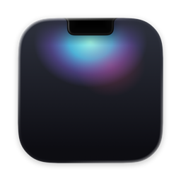
</p>

<h1 align="center">Cranny</h1>

<p align="center">
  <b>A calm home for the notch on your Mac.</b><br>
  <b>Спокойный дом для выреза вашего Mac.</b>
</p>

<p align="center">
  <a href="#english">English</a> · <a href="#русский">Русский</a> ·
  <a href="https://github.com/stansful/cranny-swift/releases/latest">Download / Скачать</a> ·
  <a href="docs/USER-GUIDE.md">User guide</a>
</p>

<p align="center">
  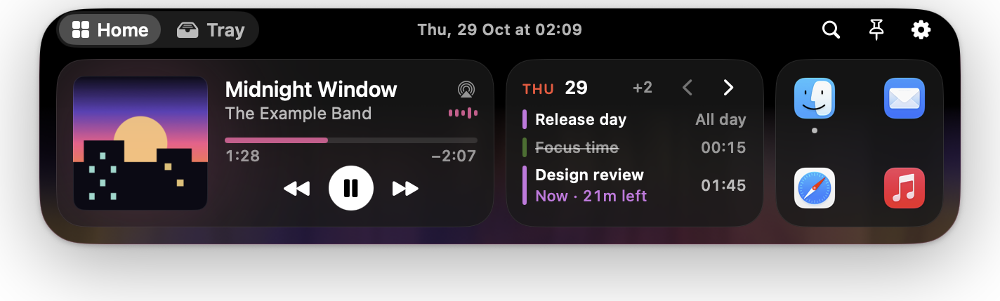
</p>

---

## English

Cranny turns the camera housing into a small panel that grows out of the hardware: what's playing, your next
meeting, a running timer, files you're moving, the volume. Glanceable when closed, a full set of widgets when you
open it. Free and open source (MIT), no account, no analytics.

### Live activities

What matters right now, right next to the camera: music, meetings with a **Join** button, timers, charging, AirPods,
the volume. Hover for a peek, swipe up to dismiss, pause them all from the menu bar.

| Now playing | Meeting | Timer | Volume |
|:-:|:-:|:-:|:-:|
| 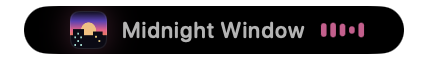 |  |  |  |

| Charging | AirPods |
|:-:|:-:|
| 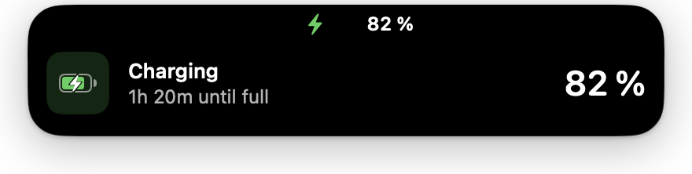 | 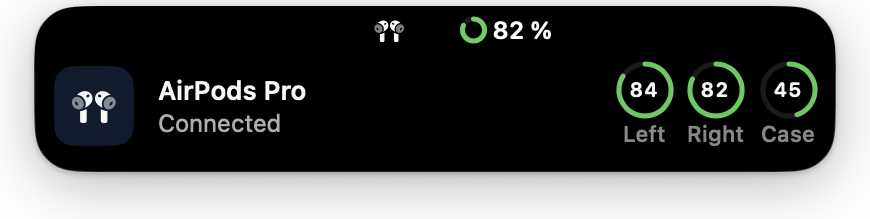 |

### Widgets

Open the notch (hover, click or **⌃⌥N**): Media, Calendar, Quick Apps & Shortcuts, Mirror, Notes, To-dos, Timer,
AirDrop and Files, on up to four pages you arrange yourself (**⌘E**).

<p align="center">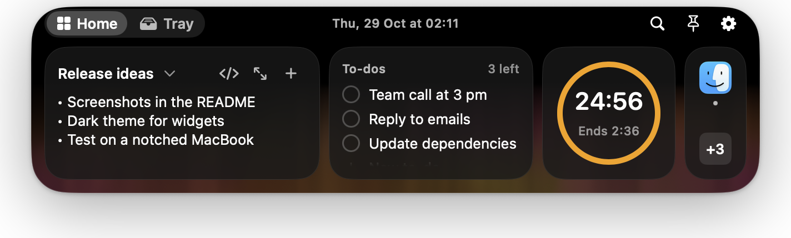</p>
<p align="center">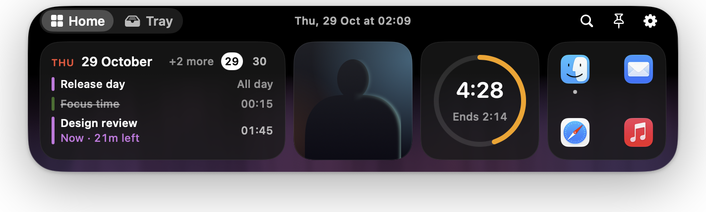</p>

### Tray

Drop files on the notch to keep them at hand, AirDrop them, or run them through pipelines: compress, convert,
resize, zip, remove background, copy text — with Undo.

<p align="center">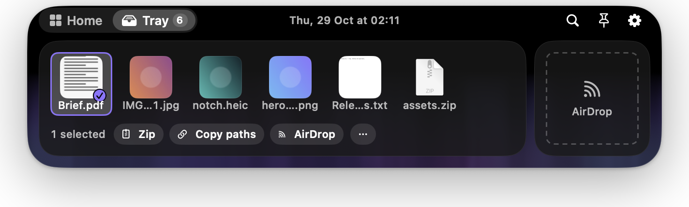</p>

### Keyboard first

**⌘K** finds any action, hold **⌘** to see every shortcut, start typing to capture a note or a to-do.

| ⌘K — command palette | Hold ⌘ — shortcuts |
|:-:|:-:|
| 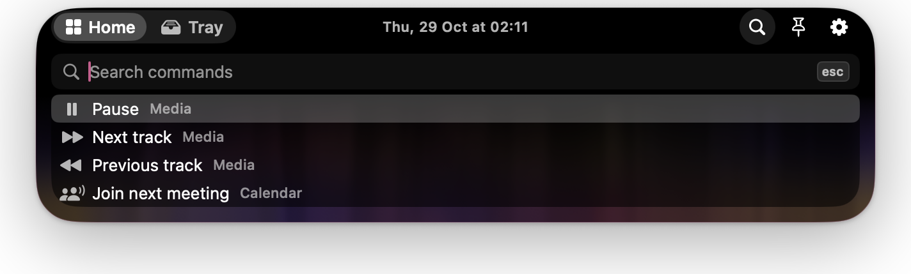 | 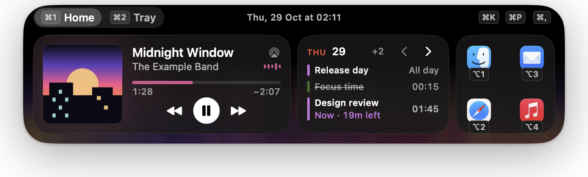 |

### Settings you can see

Pick a starting layout in the Welcome window, then fine-tune everything with a live preview of the real notch.

| Welcome | Settings |
|:-:|:-:|
| 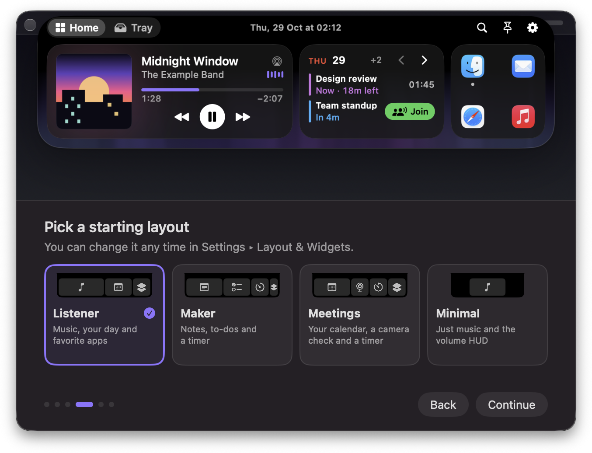 | 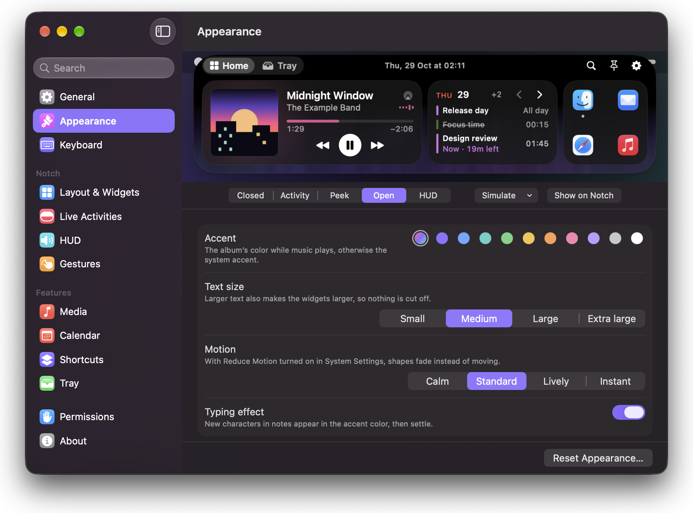 |

### Install

Requires **macOS 14 Sonoma or later**.

1. Download `Cranny-<version>.dmg` from [Releases](https://github.com/stansful/cranny-swift/releases/latest).
2. Drag **Cranny** to **Applications** and open it. It lives in the menu bar, there is no Dock icon.
3. If macOS says the app "can't be opened", click **Open Anyway** in System Settings ▸ Privacy & Security, or run:

```sh
xattr -dr com.apple.quarantine /Applications/Cranny.app
```

**Build from source:** Xcode 26+ with the Metal Toolchain, then `make build` (or `make run`). Details in the
[user guide](docs/USER-GUIDE.md#build-from-source).

### More

- Permissions, the "perl" media helper, known limitations, privacy — [docs/USER-GUIDE.md](docs/USER-GUIDE.md)
- [Contributing](docs/CONTRIBUTING.md) · [Architecture](docs/ARCHITECTURE.md) · [Design](docs/DESIGN.md) ·
  [Translations](docs/TRANSLATING.md)
- 35 languages, Reduce Motion, VoiceOver and keyboard-only use. Everything stays on your Mac.

---

## Русский

Cranny превращает вырез под камерой в маленькую панель, которая «вырастает» из корпуса: что играет, ближайшая
встреча, запущенный таймер, файлы, которые вы переносите, громкость. В закрытом виде — коротко и по делу, в открытом —
полный набор виджетов. Бесплатно и с открытым кодом (MIT), без аккаунта и аналитики.

### Активности

Самое важное прямо рядом с камерой: музыка, встречи с кнопкой **Подключиться**, таймеры, зарядка, AirPods,
громкость. Наведите курсор, чтобы заглянуть, смахните вверх, чтобы скрыть, приостановите все из строки меню.

| Сейчас играет | Встреча | Таймер | Громкость |
|:-:|:-:|:-:|:-:|
| 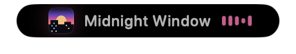 |  |  |  |

| Зарядка | AirPods |
|:-:|:-:|
| 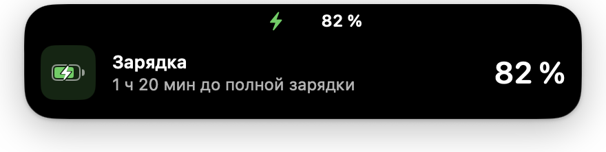 | 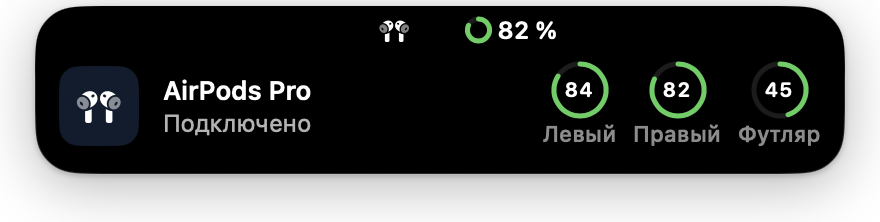 |

### Виджеты

Откройте вырез (наведите курсор, щёлкните или нажмите **⌃⌥N**): Медиа, Календарь, Быстрые приложения и Быстрые
команды, Зеркало, Заметки, Задачи, Таймер, AirDrop и Файлы — до четырёх страниц, которые вы собираете сами (**⌘E**).

<p align="center">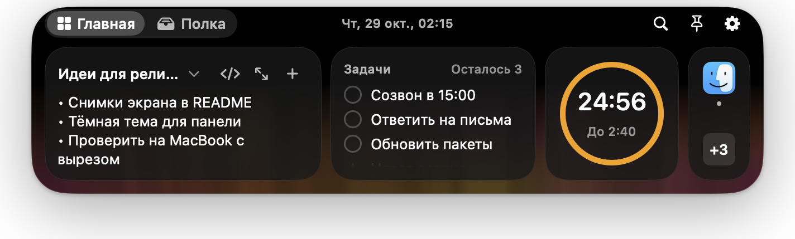</p>
<p align="center">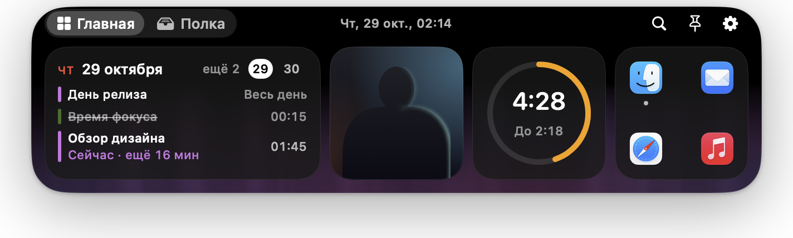</p>

### Полка

Перетащите файлы на вырез, чтобы держать их под рукой, отправить по AirDrop или обработать: сжать, конвертировать,
изменить размер, упаковать в zip, удалить фон, скопировать текст — с возможностью отменить.

<p align="center">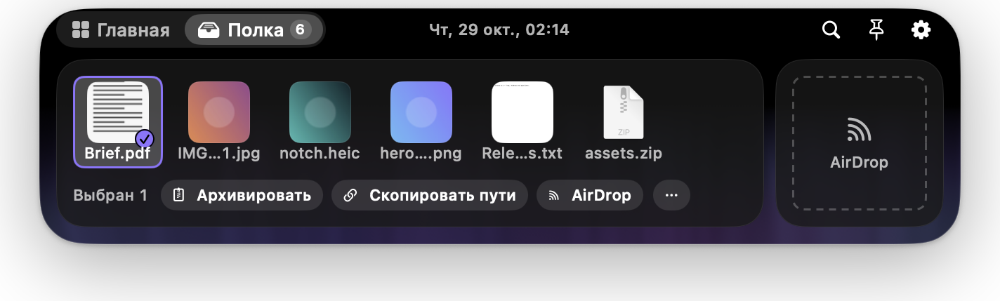</p>

### Клавиатура прежде всего

**⌘K** находит любое действие, удерживайте **⌘**, чтобы увидеть все сочетания клавиш, начните печатать, чтобы
записать заметку или задачу.

| ⌘K — палитра команд | Удерживайте ⌘ — подсказки |
|:-:|:-:|
| 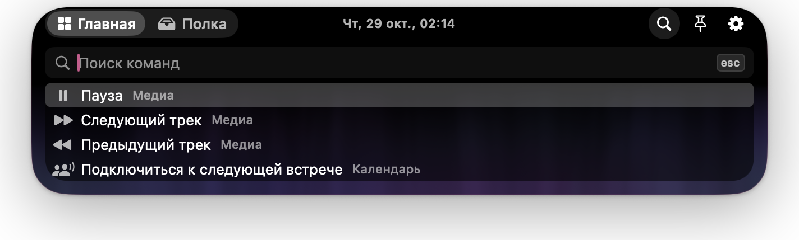 | 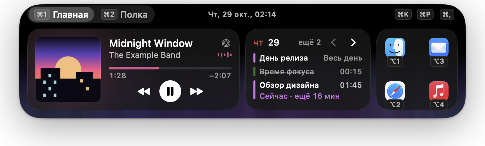 |

### Наглядные настройки

Выберите стартовую раскладку в окне приветствия, а затем настройте всё с живым предпросмотром настоящего выреза.

| Приветствие | Настройки |
|:-:|:-:|
| 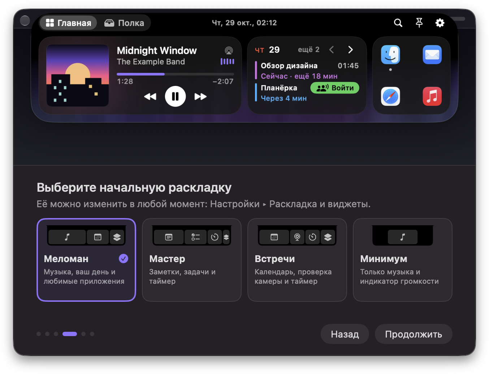 | 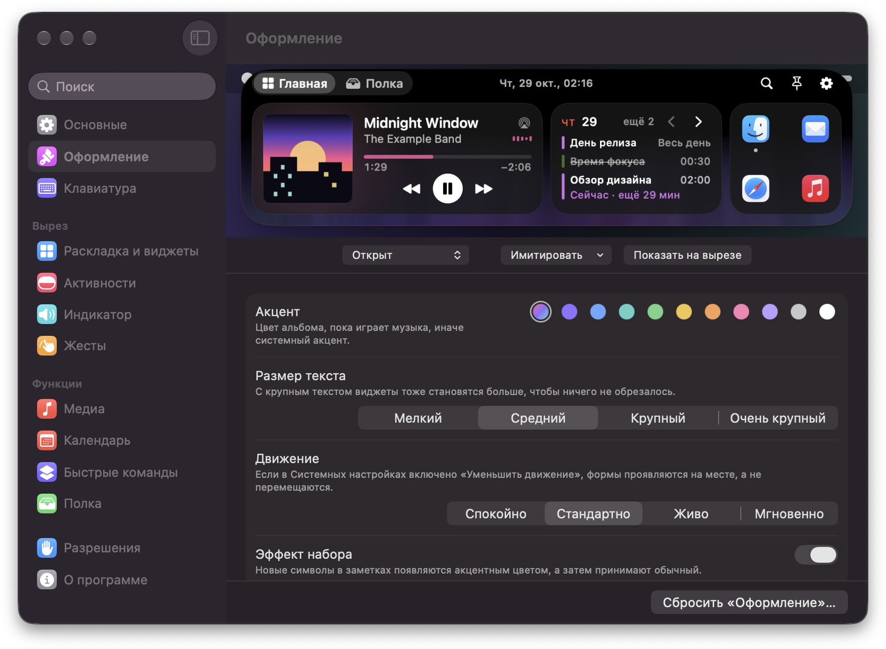 |

### Установка

Нужна **macOS 14 Sonoma или новее**.

1. Скачайте `Cranny-<версия>.dmg` со страницы [Releases](https://github.com/stansful/cranny-swift/releases/latest).
2. Перетащите **Cranny** в **Программы** и откройте. Приложение живёт в строке меню, значка в Dock нет.
3. Если macOS пишет, что приложение «не может быть открыто», нажмите **Всё равно открыть** в Системных настройках ▸
   Конфиденциальность и безопасность или выполните:

```sh
xattr -dr com.apple.quarantine /Applications/Cranny.app
```

**Сборка из исходников:** Xcode 26+ с Metal Toolchain, затем `make build` (или `make run`). Подробности — в
[руководстве](docs/USER-GUIDE.md#build-from-source) (на английском).

### Ещё

- Разрешения, медиа-помощник «perl», известные ограничения, приватность — [docs/USER-GUIDE.md](docs/USER-GUIDE.md)
- [Участие в разработке](docs/CONTRIBUTING.md) · [Архитектура](docs/ARCHITECTURE.md) · [Дизайн](docs/DESIGN.md) ·
  [Переводы](docs/TRANSLATING.md)
- 35 языков, «Уменьшение движения», VoiceOver и работа только с клавиатуры. Всё остаётся на вашем Mac.

---

<p align="center">MIT © Cranny contributors · <a href="THIRD_PARTY_NOTICES.md">Notices</a></p>
